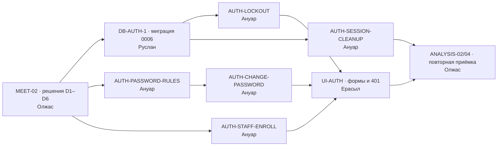

# Авторизация: задания команде

Автор: Олжас. Основание: пробелы AUTH-GAP-1…AUTH-GAP-7 из [технического описания](AUTH_TECHNICAL_DESCRIPTION.md).
Срок: до отчёта W13, если на встрече не решим иначе. Перед началом — встреча по решениям D1–D6 (15 минут).

**Как понять, что задание готово:** у каждого задания есть тест в `backend/tests/test_auth_acceptance.py` с пометкой `xfail(strict=True)`. Когда сделаешь задание, этот тест начнёт **падать с XPASS** — значит, поведение стало правильным. Удали у теста строку `@pytest.mark.xfail(...)`, прогони файл, и тест должен пройти как обычный. Это и есть доказательство в PR.

```bash
RUN_DB_TESTS=1 PYTHONPATH=backend pytest backend/tests/test_auth_acceptance.py -q -rxX
```



## Руслан — база данных

### DB-AUTH-1 · Миграция `0006_auth_hardening`

- Таблица `login_attempts`: `email` (PK, нижний регистр), `failed_count` (int, ≥ 0), `first_failed_at` (timestamptz), `locked_until` (timestamptz, NULL). Ключ — email, а не `user_id`: попытки на несуществующий email тоже считаются, иначе блокировка выдаст, что аккаунт есть.
- Индексы `login_sessions (user_id)` и `login_sessions (expires_at)`.
- `downgrade()` удаляет всё добавленное. Проверить `upgrade → downgrade → upgrade` и `alembic check` на `mini_lms_test_*`.
- Тест ограничений: отрицательный `failed_count` отклоняется, повтор email отклоняется.

**Готово:** миграция в `main`, `alembic check` чистый, отчёт о прогоне в PR.

### DB-AUTH-2 · Очистка сессий

- `database/queries/session_cleanup.sql`: `DELETE FROM login_sessions WHERE expires_at <= now()` и `EXPLAIN` до и после индекса на seed-данных.
- Записать результат в `docs/DB_TEST_REPORT.md`.

**Готово:** SQL в репозитории, план запроса показывает индекс.

