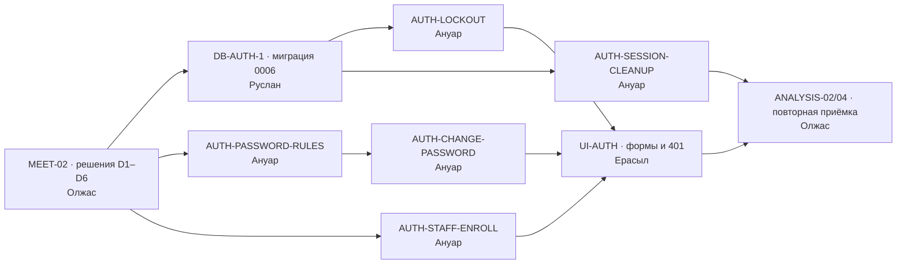

# Авторизация: задания команде

Автор: Олжас. Основание: пробелы AUTH-GAP-1…AUTH-GAP-7 из [технического описания](AUTH_TECHNICAL_DESCRIPTION.md).
Срок: до отчёта W13, если на встрече не решим иначе. Перед началом — встреча по решениям D1–D6 (15 минут).

**Как понять, что задание готово:** у каждого задания есть тест в `backend/tests/test_auth_acceptance.py` с пометкой `xfail(strict=True)`. Когда сделаешь задание, этот тест начнёт **падать с XPASS** — значит, поведение стало правильным. Удали у теста строку `@pytest.mark.xfail(...)`, прогони файл, и тест должен пройти как обычный. Это и есть доказательство в PR.

```bash
RUN_DB_TESTS=1 PYTHONPATH=backend pytest backend/tests/test_auth_acceptance.py -q -rxX
```



## Руслан — база данных

### DB-AUTH-1 · Миграция `0006_auth_hardening`

- Таблица `login_attempts`: `email` (PK, нижний регистр), `failed_count` (int, ≥ 0), `first_failed_at` (timestamptz), `locked_until` (timestamptz, NULL). Ключ — email, а не `user_id`: попытки на несуществующий email тоже считаются, иначе блокировка выдаст, что аккаунт есть.
- Индексы `login_sessions (user_id)` и `login_sessions (expires_at)`.
- `downgrade()` удаляет всё добавленное. Проверить `upgrade → downgrade → upgrade` и `alembic check` на `mini_lms_test_*`.
- Тест ограничений: отрицательный `failed_count` отклоняется, повтор email отклоняется.

**Готово:** миграция в `main`, `alembic check` чистый, отчёт о прогоне в PR.

### DB-AUTH-2 · Очистка сессий

- `database/queries/session_cleanup.sql`: `DELETE FROM login_sessions WHERE expires_at <= now()` и `EXPLAIN` до и после индекса на seed-данных.
- Записать результат в `docs/DB_TEST_REPORT.md`.

**Готово:** SQL в репозитории, план запроса показывает индекс.

## Ануар — backend

### AUTH-LOCKOUT · Защита от перебора (AUTH-GAP-1, решение D1)

- В `login()`: если у email `locked_until > now()` — 429 «Слишком много попыток, попробуйте через N минут» и заголовок `Retry-After` в секундах, пароль не проверять.
- Неудачный вход: `failed_count + 1`; если окно 15 минут истекло — начать счёт заново; на 5-й неудаче поставить `locked_until = now() + 15 минут`.
- Успешный вход удаляет строку `login_attempts` для этого email.
- Обновление счётчика — одной транзакцией с блокировкой строки (`SELECT ... FOR UPDATE` или `INSERT ... ON CONFLICT DO UPDATE`), иначе параллельные попытки обойдут лимит.

**Готово:** `test_au20_login_locked_after_five_failures` проходит без xfail. Зависит от DB-AUTH-1.

### AUTH-PASSWORD-RULES · Правила пароля (AUTH-GAP-2, решение D2)

- Одна функция проверки для регистрации и смены пароля: ≥ 8 символов, есть буква, есть цифра, не совпадает с email. Ошибка 422 с понятным текстом.
- Существующие пароли не трогать.

**Готово:** `test_au21_trivial_password_rejected` проходит без xfail, остальные тесты регистрации зелёные.

### AUTH-CHANGE-PASSWORD · Смена пароля (AUTH-GAP-3, решение D3)

- `POST /api/me/password`, тело `{current_password, new_password}`, `extra="forbid"`.
- Неверный текущий пароль — 403. Новый пароль — по правилам AUTH-PASSWORD-RULES.
- После смены удалить все сессии пользователя, кроме текущей.

**Готово:** `test_au22_user_can_change_password` проходит без xfail. Зависит от AUTH-PASSWORD-RULES.

### AUTH-SESSION-CLEANUP · Удаление просроченных сессий (AUTH-GAP-4)

- В `start_session()` перед созданием новой сессии удалить просроченные сессии этого пользователя.

**Готово:** `test_au23_expired_sessions_cleaned_on_login` проходит без xfail. Зависит от DB-AUTH-1 (индекс).

### AUTH-STAFF-ENROLL · Запись только для учеников (AUTH-GAP-5, решение D4)

- В `enroll()`: если роль не `student` — 403 «Записываться на курсы могут только ученики».

**Готово:** `test_au24_staff_cannot_self_enroll` проходит без xfail; `test_au13_permission_matrix` зелёный.

### AUTH-DEMO-REMOVE · Убрать `/api/demo/*` (решение D5)

- Удалить демо-эндпоинты и их тесты, если на встрече решим их убрать. Проверить, что фронт их больше не вызывает.

