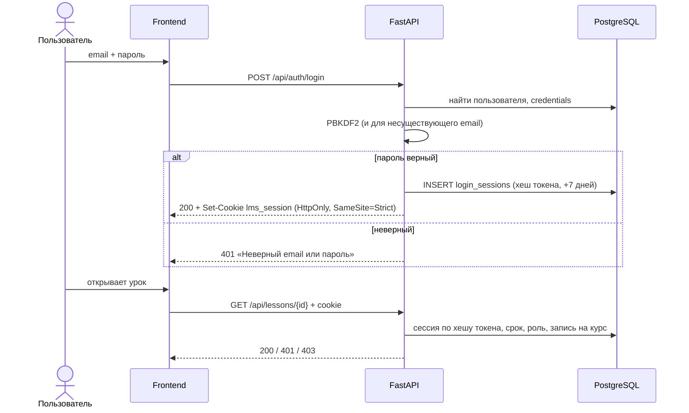
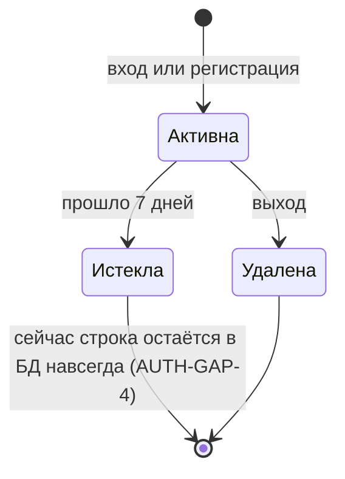

# Авторизация и права доступа: техническое описание

| | |
|---|---|
| Версия | 1.0 от 16 ноября 2026 |
| Автор | Олжас, системный аналитик |
| Основа | `main`, коммит `0ab8cc0` (вход и сессии — `04b9ee4`, регистрация и роли — `0ee0a96`) |
| Проверка | [сценарии приёмки](../testing/AUTH_ACCEPTANCE.md), автотесты `backend/tests/test_auth_acceptance.py` |
| Задачи по пробелам | [AUTH_TASKS.md](AUTH_TASKS.md) |
| Закрывает | ANALYSIS-02 (аккаунты) и ANALYSIS-04 (матрица прав) |

## 1. Термины

- **Аутентификация** — кто ты: вход по email и паролю, сессия.
- **Авторизация** — что тебе можно: роль и связь с курсом.
- **Сессия** — запись в `login_sessions`, которая связывает случайный токен из cookie `lms_session` с пользователем.
- **Персонал** — роли `teacher` и `admin`.

## 2. Объём

**Реализовано:** регистрация (сразу роль `student` и вход), вход, выход, серверные сессии на 7 дней, профиль (имя и описание), три роли, смена роли администратором, проверка доступа к курсу на каждом запросе.

**Не реализовано:** защита от перебора пароля, правила сложности пароля, смена пароля, очистка просроченных сессий, выход на всех устройствах, восстановление пароля по email (вне объёма пяти недель, см. NOT_DONE_ON_PURPOSE).

## 3. Бизнес-правила (как работает сейчас)

| № | Правило | Где в коде |
|---|---|---|
| A1 | Регистрация создаёт только ученика. Поле `role` в запросе — 422 | `register()`, `Register` (`extra="forbid"`) |
| A2 | Email хранится в нижнем регистре без пробелов по краям; повтор (в любом регистре) — 409 | `register()`, `uq_users_email`, `ck_users_email` |
| A3 | Пароль 8–200 символов. Других требований нет | `Register.password` |
| A4 | Пароль хранится как PBKDF2-SHA256, 600 000 итераций, случайная соль; сравнение за постоянное время | `security.py` |
| A5 | Неверный пароль и несуществующий email дают одинаковый ответ 401 «Неверный email или пароль» и одинаковое время (хеш считается и для несуществующего) | `login()` |
| A6 | Пользователь без пароля (старый seed) войти не может | `login()` |
| A7 | При входе и регистрации создаётся сессия: токен 32 байта в cookie, в БД только SHA-256 токена, срок 7 дней | `start_session()` |
| A8 | Cookie: `HttpOnly`, `SameSite=Strict`, `Max-Age=604800`; `Secure` только при `COOKIE_SECURE=1` | `start_session()` |
| A9 | Выход удаляет текущую сессию; без cookie выход тоже отвечает 200 | `logout()` |
| A10 | Каждый защищённый запрос ищет сессию по хешу токена и проверяет срок; нет или истекла — 401 | `current()` |
| A11 | Роль читается из БД на каждом запросе: повышение и понижение роли действуют сразу, без повторного входа | `role()` |
| A12 | Роль меняет только администратор; свою роль менять нельзя (403), поэтому последний администратор не может пропасть сам | `set_role()` |
| A13 | Профиль меняет только имя и описание; поля `role`, `email` — 422 | `ProfileInput` |
| A14 | Доступ к курсу: администратор — любой; преподаватель — автор или назначенный; ученик — курс опубликован и есть запись | `access()`, `owned()` |
| A15 | Каталог опубликованных курсов открыт без входа; страница курса — только после входа | `catalog()`, `course_detail()` |
| A16 | Записаться на опубликованный курс может любой вошедший пользователь, в том числе персонал | `enroll()` (см. AUTH-GAP-5) |

## 4. Сценарии

## 5. Матрица прав

Фактические коды ответа, проверены автотестом `test_au13_permission_matrix` 16 ноября. Курс — Calculus 1. «Чужой преп.» — преподаватель, который не автор и не назначен на этот курс. «Другой уч.» — ученик, не записанный на курс.

| Эндпоинт | Гость | Ученик курса | Другой уч. | Преп. курса | Чужой преп. | Админ |
|---|---|---|---|---|---|---|
| `GET /api/me`, `PATCH /api/me` | 401 | 200 | 200 | 200 | 200 | 200 |
| `GET /api/courses` (каталог) | 200 | 200 | 200 | 200 | 200 | 200 |
| `GET /api/courses/{id}` | 401 | 200 | 403 | 200 | 403 | 200 |
| `GET /api/lessons/{id}`, `POST .../complete` | 401 | 200 | 403 | 200 | 403 | 200 |
| `GET /api/courses/{id}/quiz` | 401 | 200 | 403 | 200 | 403 | 200 |
| `GET /api/me/courses`, `/me/gradebook` | 401 | 200 | 200 | 200 | 200 | 200 |
| `GET /api/staff/courses`, `/staff/students` | 401 | 403 | 403 | 200 | 200 (только свои) | 200 |
| `GET /api/staff/students?course_id={id}` | 401 | 403 | 403 | 200 | 403 | 200 |
| `GET /api/staff/courses/{id}/students/{uid}` | 401 | 403 | 403 | 200 | 403 | 200 |
| `PUT /api/staff/courses/{id}/grades` | 401 | 403 | 403 | 200 | 403 | 200 |
| `POST /api/staff/courses` | 401 | 403 | 403 | 200 | 200 | 200 |
| `PUT /api/staff/courses/{id}`, `/modules/{id}`, `/lessons/{id}` | 401 | 403 | 403 | 200 | 403 | 200 |
| `DELETE /api/staff/courses/{id}` | 401 | 403 | 403 | не проверялось | 403 | не проверялось |
| `GET /api/admin/users`, `PUT /api/admin/users/{id}/role` | 401 | 403 | 403 | 403 | 403 | 200 |

Вывод: ученик не попадает в разделы персонала, преподаватель — в чужие курсы и администрирование, гость — никуда, кроме каталога. Отклонений от правил A11–A15 нет.

## 6. API

| Метод и путь | Тело | Ответ | Ошибки |
|---|---|---|---|
| `POST /api/auth/register` | `email, password, display_name` | 201, профиль, cookie | 409 email занят; 422 короткий пароль, неверный email, пустое имя, лишние поля |
| `POST /api/auth/login` | `email, password` | 200, профиль, cookie | 401 |
| `POST /api/auth/logout` | — | 200, cookie удалена | — |
| `GET /api/me` | — | `id, email, display_name, role, bio` | 401 |
| `PATCH /api/me` | `display_name, bio` | профиль | 401, 422 |
| `GET /api/admin/users` | — | список пользователей | 401, 403 |
| `PUT /api/admin/users/{id}/role` | `role` | профиль | 401, 403 (не админ или своя роль), 404, 422 |

