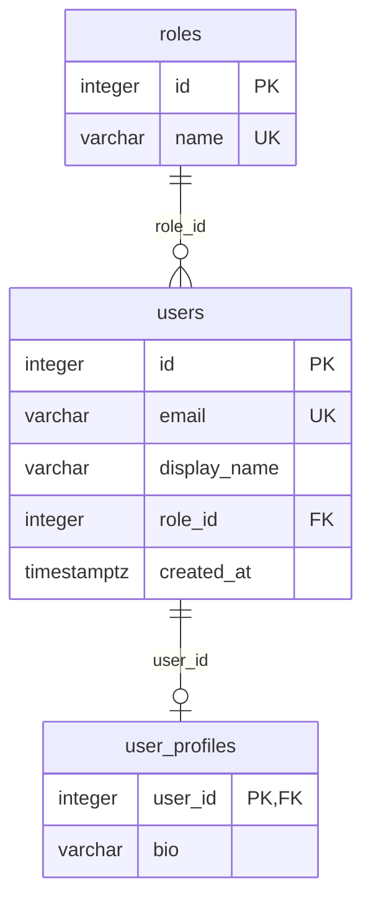
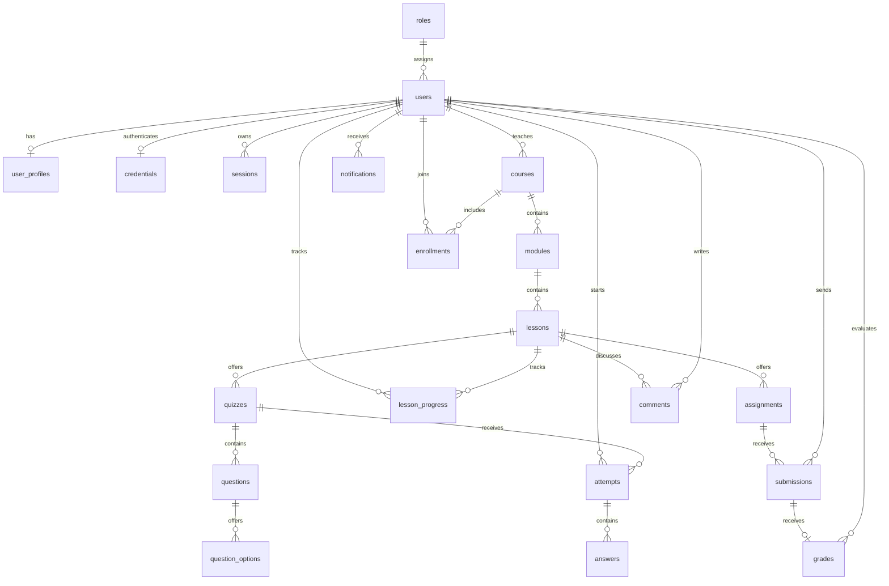

# База данных Mini LMS: руководство Руслана

## Зачем нужна БД
React показывает интерфейс, FastAPI принимает запросы, PostgreSQL хранит данные. Без БД аккаунты, ответы и оценки исчезнут после перезапуска либо останутся только в одном браузере. Mock-данные полезны для макета, но не заменяют хранение и проверку доступа.

Пример потока: студент отправляет ответ → backend проверяет сессию и право на попытку → в транзакции записывает ответы и результат → БД проверяет ограничения → backend возвращает подтверждение → интерфейс показывает результат.

## Основные понятия
| Понятие | Простое объяснение | Пример |
|---|---|---|
| Таблица | Набор записей одного вида | users |
| Строка | Один объект | один студент |
| Поле | Свойство объекта | email |
| Тип | Какие значения допустимы | integer, varchar, boolean, timestamptz |
| Первичный ключ (PK) | Однозначный идентификатор строки | users.id |
| Внешний ключ (FK) | Ссылка на существующую строку | users.role_id → roles.id |
| NOT NULL | Значение обязательно | email |
| UNIQUE | Повторов быть не должно | email, пара attempt_id/question_id |
| CHECK | Дополнительное правило | оценка неотрицательна |
| DEFAULT | Значение по умолчанию | время создания |
| Индекс | Структура для ускорения поиска | уникальный индекс email |
| Транзакция | Несколько действий целиком либо ни одного | ответы и итог попытки |
| View | Сохранённый SELECT, обычно без собственной копии данных | отчёт по результатам |
| Миграция | Версия изменения схемы | добавить таблицу courses |
| Seed | Явное заполнение примерами | три тестовых пользователя |

Числа храним числовыми типами, время — timestamptz, email — строкой, оценку с дробной частью — numeric, если это нужно согласованным правилам. Не используем float для точных баллов. Пароль нельзя хранить открытым текстом: backend вычисляет современный хеш. В текущем скелете паролей вообще нет.

## Связи
- **1:1:** user_profiles.user_id — одновременно PK и FK. Один профиль относится к одному пользователю.
- **1:N:** одна роль у многих пользователей. В этой минимальной модели у пользователя ровно одна роль.
- **M:N:** студент может учиться на нескольких курсах, курс — содержать много студентов. Связующая таблица enrollments хранит user_id и course_id с уникальностью пары.

Если позже нужны несколько ролей одновременно, добавляется user_roles отдельной миграцией, а не список ролей в текстовом поле.

## Нормализация
Сведения хранятся в одном ответственном месте. Название роли не повторяется в каждом пользователе — используется role_id. Не нужно помещать уроки списком через запятую в поле курса. Не храните имя преподавателя в каждой оценке, если оно выводится через связи. Осознанный снимок вопроса в попытке — другое: он сохраняет историческую версию, чтобы изменение курса не меняло прошлый результат.

## Что создано сейчас
Только три предметные таблицы и служебная alembic_version:
- roles: id, name; допустимы student, teacher, admin.
- users: id, email, display_name, role_id, created_at; email уникален и хранится в нижнем регистре.
- user_profiles: user_id, bio; профиль удаляется вместе с пользователем.

CHECK email проверяет только минимальную форму, а не существование почтового адреса. Полная валидация регистрации относится к backend W12.



## Целевая схема: ещё не создана
Это учебный ориентир, а не миграция. Поля и правила утверждаются перед своей неделей. Comments и notifications — после пяти недель, если команда отдельно согласует их.

| Сущность | Назначение и основные связи | Срок |
|---|---|---|
| users, roles, user_profiles | Учётные записи, роль и профиль | скелет |
| credentials / sessions | Хеш пароля пользователя, сессии и отзыв; окончательное разбиение согласовать с backend | W12 |
| courses | Курс, автор users, состояние публикации | W12 |
| modules | Раздел курса, FK course_id, порядок | W12 |
| lessons | Урок модуля, FK module_id, содержание и порядок | W12 |
| enrollments | M:N users ↔ courses, уникальность пары | W13 |
| quizzes | Тест урока, настройки | W13 |
| questions | Вопрос теста и порядок | W13 |
| question_options | Варианты вопроса и серверный признак правильности | W13 |
| attempts | Попытка пользователя, статус, итог и снимок вопросов | W13 |
| answers | Ответ попытки на вопрос снимка; уникальность пары | W13 |
| lesson_progress | Пользователь ↔ урок, отметка завершения | W13 |
| assignments | Задание урока и максимальный балл | W14 |
| submissions | Текстовое решение пользователя по заданию | W14 |
| grades | Оценка сдачи, автор проверки, комментарий | W14 |
| comments | Обсуждение урока с автором; не включено в обязательный объём | после W15 |
| notifications | Личное уведомление и признак прочтения; не включено в обязательный объём | после W15 |



Answers ссылаются на идентификаторы вопросов/вариантов **снимка попытки**, а не обязательно на изменяемый question_options. Физическое устройство снимка (отдельные строки или JSONB с проверками) утверждается в DB-03. Диаграмма показывает предметные связи, а не полный список физических FK. Для MVP предполагается одна итоговая оценка на сдачу; повторные сдачи требуют отдельного решения.

## Как проектировать по шагам
1. Записать сценарий: кто и зачем делает действие.
2. Найти сущности: студент, курс, запись на курс.
3. Выписать атрибуты и допустимые значения, включая обязательность.
4. Определить связи и действия при удалении. Исторические оценки нельзя бездумно каскадно удалять.
5. Нарисовать ER-диаграмму и проверить её на нескольких примерах.
6. Выбрать PK, FK, UNIQUE, CHECK и необходимые индексы.
7. Написать миграцию, проверить upgrade/downgrade на отдельной БД.
8. Добавить seed и позитивные/негативные проверки.
9. Сверить контракт с backend и обновить документацию.

## Как backend обращается к БД
SQLAlchemy — библиотека, которая связывает Python-объекты с таблицами и строит SQL. ORM не отменяет понимания SQL и не заменяет миграции.

```python
from sqlalchemy import select
from app.models import User

# session создана через SessionLocal; пароль и секреты не выводим.
user = session.scalar(select(User).where(User.email == normalized_email))
```

Эквивалент параметризованного SQL:
```python
from sqlalchemy import text
row = session.execute(
    text("SELECT id, display_name FROM users WHERE email = :email"),
    {"email": normalized_email},
).first()
```
Не соединяйте пользовательский ввод со строкой SQL. Проверка роли в React не защищает таблицы: backend проверяет права для каждого действия.

## Alembic, миграции и seed
Alembic записывает порядок изменений в файлах Python. В БД alembic_version хранит текущую версию. `upgrade` применяет изменения, `downgrade` выполняет обратные действия. Старую применённую миграцию не переписываем: добавляем следующую.

Autogenerate сравнивает модели и БД, но не понимает все намерения. Переименование может выглядеть как удаление и создание колонки с потерей данных. Руслан всегда читает сгенерированный файл.

Seed запускается отдельно от миграций. Он добавляет демонстрационные данные, не должен менять реальных пользователей или создавать дубликаты. Текущий seed работает в одной транзакции и использует ON CONFLICT DO NOTHING.

## Индексы и измерения
UNIQUE(email) уже создаёт индекс. Отдельный такой же индекс избыточен. PostgreSQL не создаёт индекс на каждый FK автоматически: в скелете есть ix_users_role_id. Его будущая польза зависит от объёма и запросов.

EXPLAIN показывает план, ANALYZE реально запускает запрос, BUFFERS показывает работу с блоками. На трёх пользователях последовательное чтение нормально: оно не доказывает проблему. Для оптимизации нужны воспроизводимый набор данных, одинаковый запрос, несколько запусков, размер индекса и сравнение до/после. Не запускайте ANALYZE изменяющих запросов на реальных данных без отдельного плана.

## Транзакции, views и права
Два параллельных запроса могут одновременно попытаться завершить тест. Одной проверки в Python недостаточно: нужны ограничения и согласованная транзакция, при необходимости блокировка строки. При ошибке откатываем целое действие.

View удобен для отчёта по оценкам, но не является автоматической защитой от чтения чужих данных. Материализованное view хранит результат и требует обновления; сейчас views не создаются.

Есть две системы ролей: roles в LMS определяет права пользователя приложения, а роли PostgreSQL определяют права подключения к БД. Пароль PostgreSQL не отправляется в браузер. Локальная роль из compose — удобство разработки; перед реальным размещением нужны отдельный владелец миграций и ограниченная роль приложения (DB-05).

## Бэкапы
Дамп без проверенного восстановления не доказывает надёжность. Используйте pg_dump/pg_restore, восстанавливайте в отдельную БД, сверяйте строки, ограничения и версию миграции. Инструкция — database/docs/BACKUP_RESTORE.md. Не коммитьте дампы и секреты.

## Порядок развития
W11 — проверить текущий скелет; W12 — аккаунты и содержание; W13 — запись, тесты и прогресс; W14 — задания, оценки и измерения; W15 — права, резервирование, восстановление и финальные проверки. Не добавлять будущие таблицы сейчас.

## Типичные ошибки
- Хранить список ID в строке вместо связующей таблицы.
- Полагаться только на проверку frontend, забывая ограничения БД.
- Менять схему вручную и не добавлять миграцию.
- Хранить открытые пароли или коммитить .env.
- Применять destructive downgrade к общей БД.
- Создавать индекс на каждое поле без измерения.
- Дублировать индексы PK/UNIQUE.
- Каскадно удалять исторические результаты без решения команды.
- Говорить «тесты прошли», когда не было подключения к PostgreSQL.
- Приписывать себе сгенерированный код без изучения и проверки.
