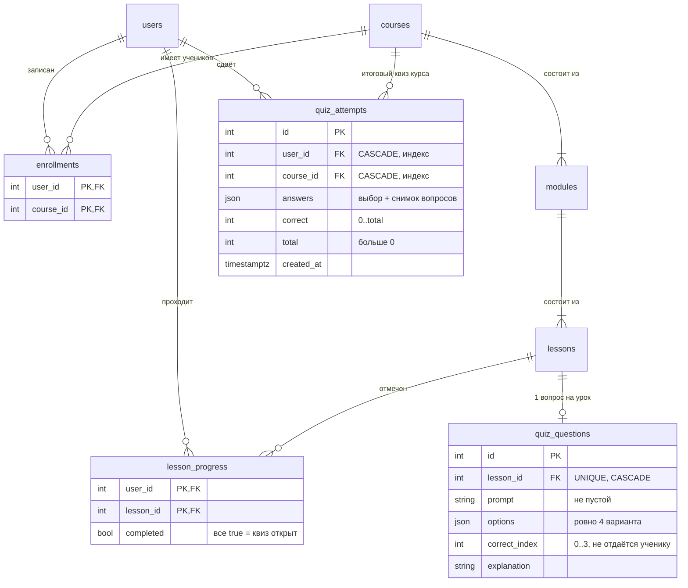
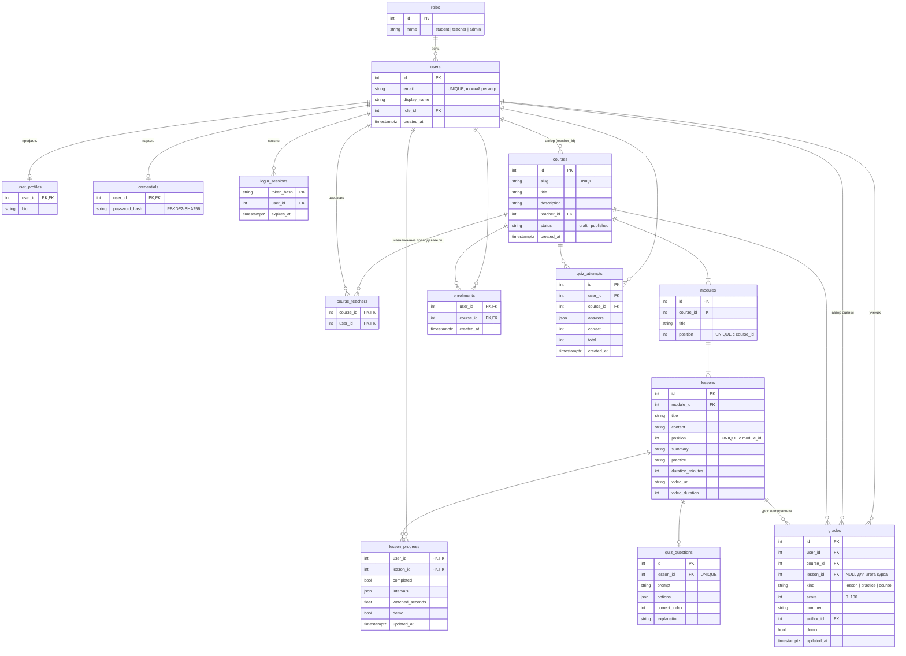

# ER-диаграмма Mini LMS

Автор: Олжас. Снято с `backend/app/models.py` на `main` (миграция `0005`, коммит `0ee0a96`) 9 ноября 2026. Источник правды — модели и миграции; при изменении схемы диаграмму обновлять в том же PR.

GitHub показывает диаграмму сразу. В VS Code нужно расширение с поддержкой Mermaid (например, «Markdown Preview Mermaid Support»).

## Квиз (крупно)

Как читать: квиз — это не отдельная таблица, а набор `quiz_questions` всех уроков курса. Квиз открывается, когда у ученика `completed = true` по каждому уроку курса и у каждого урока есть вопрос. Каждая отправка — новая строка `quiz_attempts` с подсчитанным сервером результатом.

## Вся схема

## Замечания аналитика к схеме

| № | Наблюдение | Последствие | Предложение |
|---|---|---|---|
| E1 | Результат квиза живёт в `quiz_attempts`, а не в `grades` | Журнал и карточка ученика его не видят (GAP-1, GAP-2) | Не копировать в `grades`, а показывать лучшую попытку расчётом |
| E2 | `options` и `answers` хранятся в JSON | Нельзя поставить FK на вариант; ограничения проверяет CHECK (`json_array_length = 4`) и сервер | Для объёма курса достаточно; при редакторе вопросов вынести варианты в таблицу |
| E3 | У `quiz_attempts` нет ограничения на число попыток | Попытки бесконечные, это осознанное решение (раздел 3 описания) | Если введут лимит, нужен счётчик под блокировкой, как у оценок |
| E4 | Нет индекса `(user_id, course_id)` у `quiz_attempts`, есть два отдельных | При текущих объёмах не проблема | Добавлять только после EXPLAIN на реальных данных |
