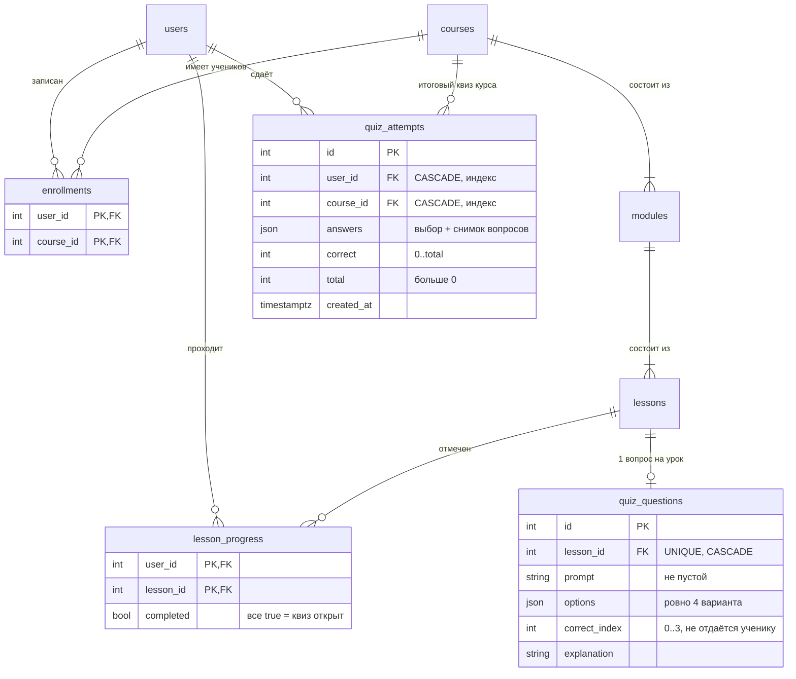

# ER-диаграмма Mini LMS

Автор: Олжас. Снято с `backend/app/models.py` на `main` (миграция `0005`, коммит `0ee0a96`) 9 ноября 2026. Источник правды — модели и миграции; при изменении схемы диаграмму обновлять в том же PR.

GitHub показывает диаграмму сразу. В VS Code нужно расширение с поддержкой Mermaid (например, «Markdown Preview Mermaid Support»).

## Квиз (крупно)

Как читать: квиз — это не отдельная таблица, а набор `quiz_questions` всех уроков курса. Квиз открывается, когда у ученика `completed = true` по каждому уроку курса и у каждого урока есть вопрос. Каждая отправка — новая строка `quiz_attempts` с подсчитанным сервером результатом.

