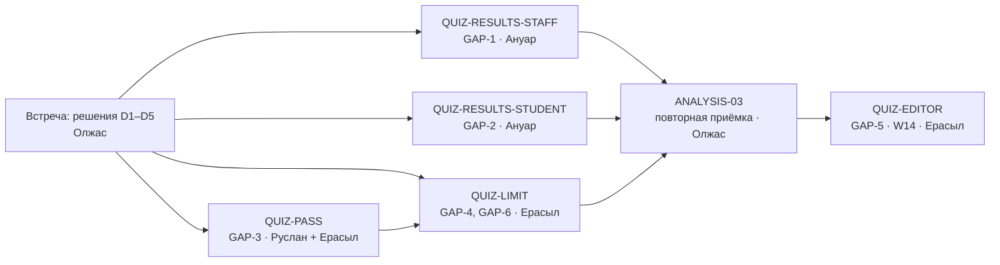

# Итоговый квиз: задачи после приёмки

Автор: Олжас. Основание: пробелы GAP-1…GAP-6 из [технического описания](QUIZ_TECHNICAL_DESCRIPTION.md) и результаты [приёмки](../testing/QUIZ_ACCEPTANCE.md).

| ID | Неделя | Владелец | Что сделать | Готово, когда | Зависит от |
|---|---|---|---|---|---|
| MEET-01 | W11 | Олжас | Встреча 15 минут: решения D1–D5, заполнить таблицу подтверждений | В описании раздел 9 подписан | — |
| QUIZ-RESULTS-STAFF | W12 | Ануар | Результат квиза в карточке ученика и колонка в списке учеников | `test_qz20` перестаёт быть xfail | MEET-01 |
| QUIZ-RESULTS-STUDENT | W12 | Ануар | Лучший результат квиза в «Моих оценках»; «не сдавал» ≠ 0% | `test_qz21` перестаёт быть xfail | MEET-01 |
| QUIZ-PASS | W12 | Руслан + Ерасыл | Поле порога у курса (миграция `0006`), `passed` в ответах | QZ-22 пройден | D2 |
| QUIZ-LIMIT | W13 | Ерасыл | Лимит попыток под блокировкой строки или правило «первая засчитывается» | QZ-23 пройден, повтор после сбоя не создаёт лишнюю попытку | D1, QUIZ-PASS |
| ANALYSIS-03 | W13 | Олжас | Повторный прогон приёмки, ручные сценарии QZ-40…QZ-43 в браузере | Все P1 пройдены | все выше |
| QUIZ-EDITOR | W14 | Ерасыл | Редактор вопросов для преподавателя | Сценарии редактора добавлены и пройдены | ANALYSIS-03 |

## Риски

| Риск | Последствие | Что делаем | Владелец |
|---|---|---|---|
| Решения D1–D2 не приняты до W12 | Ерасыл и Руслан делают каждый по-своему | Встреча на этой неделе | Олжас |
| Изменения пушатся сразу в `main` без PR | Нет ревью, сломанная сборка видна всем | Договориться: изменения через PR, CI зелёный перед слиянием | Олжас |
| Команда не знает код, собранный с помощником | На защите не объяснить | Каждый разбирает свою часть: Руслан — миграции и квиз, Ануар — `learning.py`, Ерасыл — `main.tsx` | Все |
| Нет даты показа | Нечем мерить срок | Спросить у преподавателя | Олжас |
