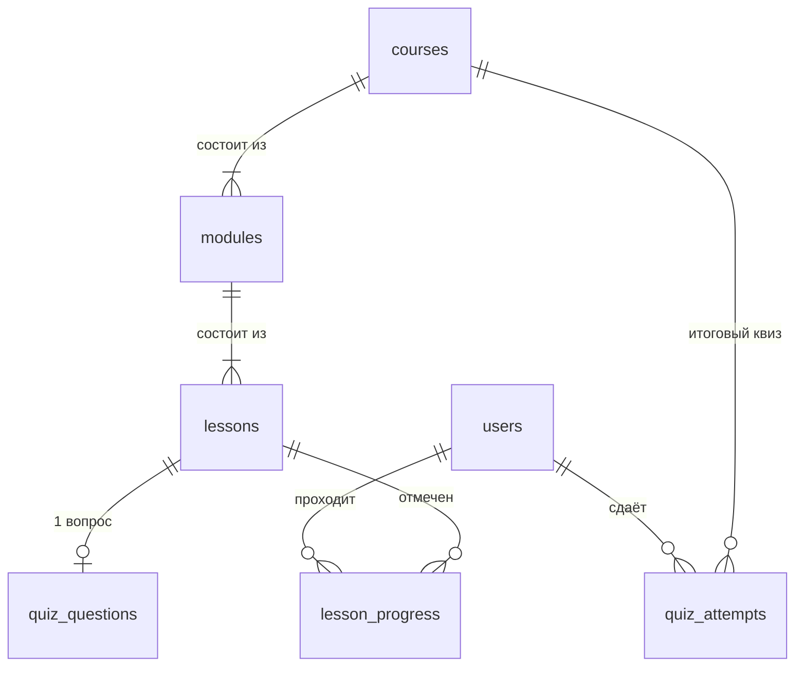
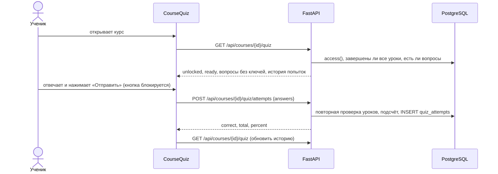

# Итоговый квиз курса: техническое описание

| | |
|---|---|
| Версия | 1.1 от 9 ноября 2026 (заменяет черновик от 5 ноября) |
| Автор | Олжас, системный аналитик |
| Основа | `main`, коммит `0ee0a96`, миграция `0005_course_quizzes` |
| Реализация | Руслан (схема, API, seed), интерфейс в `frontend/src/main.tsx` (`CourseQuiz`) |
| Проверка | [сценарии приёмки](../testing/QUIZ_ACCEPTANCE.md), автотесты `backend/tests/test_quiz_acceptance.py` |
| Статус | Описывает реализованное поведение. Раздел 7 — пробелы, которые нужно согласовать |

## 1. Назначение

Ученик заканчивает все уроки курса и проходит итоговый квиз по темам курса. Результат сохраняется на сервере и виден после обновления страницы. Преподаватель видит вопросы и правильные ответы своего курса, не проходя уроки.

## 2. Объём

**Реализовано:** итоговый квиз на курс, один вопрос на каждый урок, 4 варианта и один верный, подсчёт на сервере, история попыток ученика, таблица ответов для преподавателя и администратора, seed вопросов для всех курсов.

**Не реализовано:** порог прохождения, лимит попыток, разбор ответов для ученика, результаты квиза в журнале и карточке ученика у преподавателя, редактор вопросов. См. раздел 7.

## 3. Бизнес-правила (как работает сейчас)

| № | Правило | Где в коде |
|---|---|---|
| R1 | Квиз один на курс. Вопросы — по одному на урок (`quiz_questions.lesson_id` UNIQUE) | миграция `0005` |
| R2 | У вопроса ровно 4 варианта и один верный (`correct_index` 0–3) | CHECK `ck_quiz_options`, `ck_quiz_correct` |
| R3 | Квиз открыт ученику, если курс опубликован, ученик записан и **все** уроки курса завершены. Проверяется число завершённых уроков, а не процент | `quiz_data()` |
| R4 | Квиз готов, только если у каждого урока курса есть вопрос. Новый урок без вопроса закрывает квиз для всех | `quiz_data()`: `ready` |
| R5 | Правильные ответы и пояснения не отдаются ученику ни до, ни после отправки | `get_quiz()` |
| R6 | Ученик отвечает на все вопросы, каждый ответ — целое 0–3. Иначе 422. Поле `score` и любые лишние поля — 422 | `QuizSubmission` (`extra="forbid"`, `StrictInt`) |
| R7 | Балл считает только сервер: `percent = round(correct / total * 100)` | `submit_quiz()` |
| R8 | Каждая отправка — новая попытка; число попыток не ограничено. История показывается от новой к старой | `submit_quiz()`, `get_quiz()` |
| R9 | В попытке сохраняется снимок вопросов и вариантов на момент отправки | `quiz_attempts.answers` |
| R10 | Завершение уроков перепроверяется при каждой отправке | `quiz_data(require_open=True)` |
| R11 | Преподаватель своего или назначенного курса и администратор видят ключи ответов; отправлять попытки не могут (403) | `get_quiz()`, `submit_quiz()` |
| R12 | Результат квиза хранится отдельно от оценок преподавателя (`grades`) | модели |

## 4. Роли

| Роль | Может | Не может |
|---|---|---|
| Ученик | Открыть квиз после всех уроков, отправлять попытки, видеть свои результаты | Видеть правильные ответы, чужие попытки, отправить балл |
| Преподаватель курса | Видеть вопросы и ключи ответов | Отправлять попытки; **видеть результаты учеников** (GAP-1) |
| Администратор | То же на любом курсе | То же |

## 5. Данные

Полная схема и замечания: [ER_DIAGRAM.md](ER_DIAGRAM.md).

## 6. API

Префикс `/api`, сессия в cookie `lms_session`, ошибки `{"detail": "..."}`.

| Метод и путь | Ответ | Ошибки |
|---|---|---|
| `GET /courses/{course_id}/quiz` | `unlocked, ready, staff, total, attempts[{id, correct, total, percent, created_at}], questions[{id, topic, prompt, options}]`. Вопросы пустые, пока квиз закрыт. Для персонала в вопросах ещё `correct_index, explanation` | 401, 403 (не записан, черновик курса, чужой курс), 404 (курса нет) |
| `POST /courses/{course_id}/quiz/attempts` | `{id, correct, total, percent}` | 401; 403 (уроки не завершены, не записан, персонал); 409 (вопросы есть не у всех уроков); 422 (не все ответы, индекс вне 0–3, не число, чужой вопрос, лишние поля) |

Тело отправки: `{"answers": {"<question_id>": <индекс 0–3>, ...}}`.

## 7. Пробелы и предложения

Подтверждены автотестами и проверками 9 ноября.

| ID | Пробел | Почему важно | Предложение | Кто |
|---|---|---|---|---|
| GAP-1 | Преподаватель не видит результаты квиза учеников | По плану W13 нужно показать сохранённый результат; преподаватель курса не может оценить итог | В `GET /staff/courses/{id}/students/{user_id}` добавить `quiz: {best_percent, attempts, last_at}`; в списке учеников — колонку «Квиз» | Ануар |
| GAP-2 | В «Моих оценках» ученика нет квиза | Ученик видит итог только на странице курса | В `GET /me/gradebook` добавить лучший процент; «не сдавал» отличать от 0% | Ануар |
| GAP-3 | Нет порога «сдан / не сдан» | Без порога квиз не влияет на итог | Порог 70%, хранить на курсе (`courses.quiz_pass_percent`), в ответе — `passed` | Руслан + Ерасыл |
| GAP-4 | Попытки не ограничены, а ученик видит процент после каждой | За несколько попыток ответы можно подобрать: 10 вопросов × 4 варианта | Либо лимит 3 попытки и лучшая засчитывается, либо засчитывать первую, а остальные считать тренировкой. Решение на встрече | Команда |
| GAP-5 | Нет редактора вопросов | Вопросы генерирует seed из текста уроков; преподаватель их не меняет | Отложить на W14 вместе со STAFF-02 | Ерасыл |
| GAP-6 | Повтор запроса после сбоя сети создаёт вторую попытку | Пока попытки бесконечные, это безвредно; станет ошибкой при лимите (GAP-4) | Решать вместе с GAP-4 | Ерасыл |

Качество вопросов (проверено на 120 вопросах seed): дублей вариантов нет, правильный вариант самый длинный только в 27 из 120 случаев, правильные ответы распределены по позициям ровно (28 / 36 / 30 / 26). Угадать по форме нельзя. Ограничение: все вопросы однотипные («какое объяснение соответствует теме»), это проверка понимания тем, а не решение задач. Так и написано в [COURSE_QUIZZES.md](COURSE_QUIZZES.md).

## 8. Критерии приёмки

Приняты, когда все сценарии P1 из [QUIZ_ACCEPTANCE.md](../testing/QUIZ_ACCEPTANCE.md) проходят на чистой БД, а пробелы раздела 7 либо закрыты, либо явно отложены решением команды.

## 9. Решения для встречи

| № | Вопрос | Предложение аналитика |
|---|---|---|
| D1 | Что делаем с попытками (GAP-4) | Лимит 3, засчитывается лучшая |
| D2 | Нужен ли порог (GAP-3) | Да, 70% |
| D3 | Где преподаватель видит результат (GAP-1) | Карточка ученика + колонка в списке |
| D4 | Редактор вопросов | W14 |
| D5 | Дата показа W13 | Узнать у преподавателя |

| Участник | Подтвердил | Дата |
|---|---|---|
| Руслан | | |
| Ерасыл | | |
| Ануар | | |
