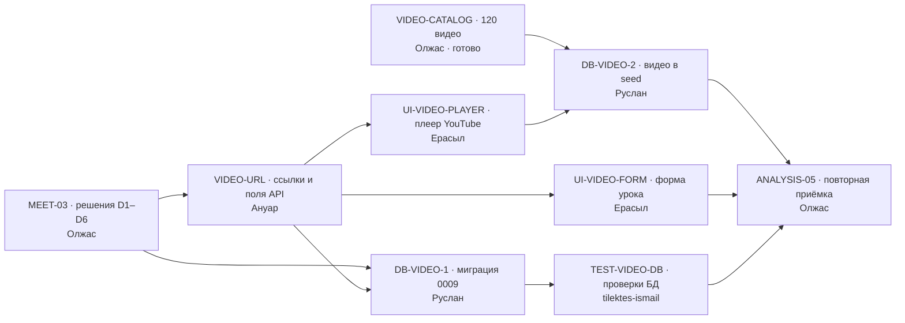

# Видео YouTube: задания команде

Автор: Олжас. Основание: пробелы VID-GAP-1…6 из [технического описания](VIDEO_TECHNICAL_DESCRIPTION.md).
Срок: до отчёта W14, если на встрече не решим иначе. Перед началом — встреча по решениям D1–D6 (15 минут).

**Готовый вклад аналитика:** каталог из 120 видео ([LESSON_VIDEOS.md](LESSON_VIDEOS.md), данные — `database/seeds/lesson_videos.py`), скрипт проверки доступности, приёмочные тесты.

**Как понять, что задание готово:** у задания есть тест в `backend/tests/test_video_acceptance.py` с пометкой `xfail(strict=True)` или ручной сценарий в [VIDEO_ACCEPTANCE.md](../testing/VIDEO_ACCEPTANCE.md). Сделал задание — тест падает с **XPASS**. Удали строку `@pytest.mark.xfail(...)`, прогони файл, тест должен пройти. Это доказательство в PR.

```bash
RUN_DB_TESTS=1 PYTHONPATH=backend pytest backend/tests/test_video_acceptance.py -q -rxX
```



> **Порядок важен.** DB-VIDEO-2 вливать только после UI-VIDEO-PLAYER. Урок с видео нельзя завершить кнопкой (V3). Если видео появятся в БД раньше плеера, все 120 уроков станут незавершаемыми, и квизы не откроются.

