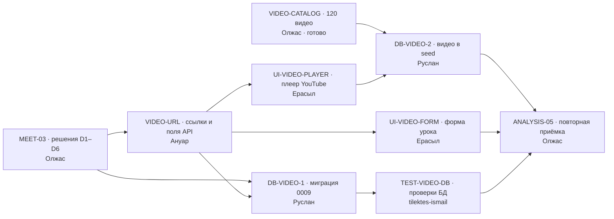

# Видео YouTube: задания команде

Автор: Олжас. Основание: пробелы VID-GAP-1…6 из [технического описания](VIDEO_TECHNICAL_DESCRIPTION.md).
Срок: до отчёта W14, если на встрече не решим иначе. Перед началом — встреча по решениям D1–D6 (15 минут).

**Готовый вклад аналитика:** каталог из 120 видео ([LESSON_VIDEOS.md](LESSON_VIDEOS.md), данные — `database/seeds/lesson_videos.py`), скрипт проверки доступности, приёмочные тесты.

**Как понять, что задание готово:** у задания есть тест в `backend/tests/test_video_acceptance.py` с пометкой `xfail(strict=True)` или ручной сценарий в [VIDEO_ACCEPTANCE.md](../testing/VIDEO_ACCEPTANCE.md). Сделал задание — тест падает с **XPASS**. Удали строку `@pytest.mark.xfail(...)`, прогони файл, тест должен пройти. Это доказательство в PR.

```bash
RUN_DB_TESTS=1 PYTHONPATH=backend pytest backend/tests/test_video_acceptance.py -q -rxX
```



> **Порядок важен.** DB-VIDEO-2 вливать только после UI-VIDEO-PLAYER. Урок с видео нельзя завершить кнопкой (V3). Если видео появятся в БД раньше плеера, все 120 уроков станут незавершаемыми, и квизы не откроются.

## Ануар — backend

### VIDEO-URL · Приём ссылок YouTube и поля API (VID-GAP-1, VID-GAP-3; Y1–Y3, Y5)

- В `LessonInput.video()` ([learning.py:743](../backend/app/learning.py#L743)): если хост `youtube.com`, `www.youtube.com`, `m.youtube.com`, `youtu.be`, `youtube-nocookie.com` или `www.youtube-nocookie.com` — достать ID из `watch?v=`, `/embed/` или пути `youtu.be`, проверить `^[A-Za-z0-9_-]{11}$` и заменить ссылку на `https://www.youtube.com/watch?v=ID`.
- Плейлист без `v`, канал, `/shorts/`, неверный ID — 422 «Нужна ссылка на одно видео YouTube».
- Разбирать через `urllib.parse`, не регуляркой по всей строке: `youtube.com.evil.test` — не YouTube.
- `get_lesson()` ([learning.py:376](../backend/app/learning.py#L376)): добавить `video_provider` (`"youtube"`, `"html5"` или `None`) и `youtube_id`. Одна функция определения на сервере, фронт ссылку не разбирает.
- Остальные ссылки HTML5 — как сейчас.

**Готово:** `test_vd20` и все 4 случая `test_vd21` проходят без xfail; `test_learning.py` зелёный.

## Руслан — база данных и seed

### DB-VIDEO-1 · Миграция `0009_youtube_video_url` (VID-GAP-1; Y4)

- Ограничение `ck_lessons_youtube_url` из раздела 5 описания: `NOT VALID`, затем `VALIDATE`.
- Перед ним — запрос на неподходящие строки. Если они есть, миграция сначала приводит их к форме `watch?v=ID` (функция та же, что у Ануара).
- `downgrade()` снимает ограничение. Проверить `upgrade → downgrade → upgrade` и `alembic check`.
- То же ограничение — в `models.py`, иначе `alembic check` покажет расхождение.

**Готово:** `test_vd22` проходит без xfail. Зависит от VIDEO-URL (общая функция нормализации).

### DB-VIDEO-2 · Видео из каталога в seed (VID-GAP-4; Y10, решения D3, D4)

- Функция `apply(s)` в `database/seeds/lesson_videos.py`. Для каждого курса из `VIDEOS` найти уроки по названию. Если `video_url` пуст — поставить `watch_url(id)` и `seconds`. Иначе не трогать.
- Демо-прогресс не удалять (D3). `duration_minutes` — по решению D4.
- Вызвать `apply()` в `learning_demo.py` после создания уроков, чтобы `make up` поднимал курсы с видео.
- С видео в seed падает `test_completion_survives_new_login_and_is_private` (проверено 23.11 черновой `apply()`): он завершает урок кнопкой и получает 422. Тесту нужен урок без видео — чинить тест, а не правило V3.

**Готово:** `test_vd23`, `test_vd24` без xfail; `test_learning.py`, `test_quiz_acceptance.py` зелёные. **Влить после UI-VIDEO-PLAYER.**

## Ерасыл — frontend

### UI-VIDEO-PLAYER · Плеер YouTube с учётом просмотра (VID-GAP-2; Y6–Y9)

- Компонент `YouTubeVideo` рядом с `TrackedVideo` ([main.tsx:583](../frontend/src/main.tsx#L583)); в `LessonView` выбирать его по `video_provider === "youtube"`.
- Скрипт `https://www.youtube.com/iframe_api` загружать один раз (общий промис), `host: "https://www.youtube-nocookie.com"`, `playerVars: { rel: 0, origin: location.origin, playsinline: 1 }`.
- Учёт: **каждые 250 мс** в состоянии `PLAYING` читать `getCurrentTime()` и `getPlaybackRate()` и передавать в ту же логику `tick()/flush()/reset()`. Её лучше вынести в общую функцию, чтобы два плеера считали одинаково. `PAUSED`, `BUFFERING`, `ENDED`, `onPlaybackRateChange`, скрытая вкладка — `reset()`.
- `onReady`: сверить `getDuration()` с `video_duration` (Y8). `onError` 2/5/100/101/150 — сообщение и ссылка «Открыть на YouTube» (Y9).
- Убирать плеер при уходе со страницы (`destroy()`), отправлять последний участок.
- Плеер в ширину блока, пропорции 16:9.

**Готово:** QA-50…QA-57 и QA-59 пройдены, запись экрана QA-55 и QA-56 в PR.

### UI-VIDEO-FORM · Форма урока (Y11)

- Подсказка поля: «Ссылка на HTML5-видео или YouTube» вместо «не iframe» ([main.tsx:1452](../frontend/src/main.tsx#L1452)); текст 422 сервера показывать как есть.

**Готово:** QA-58 пройден. Зависит от VIDEO-URL.

