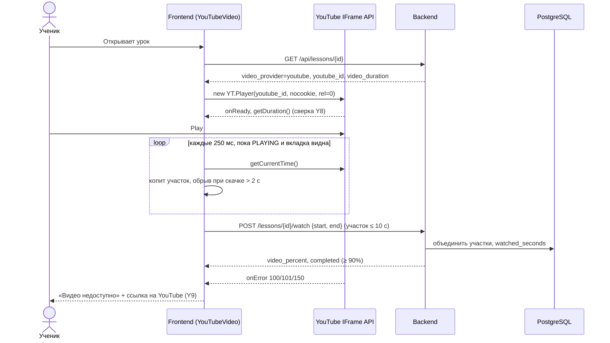

# Видео YouTube в уроках: техническое описание

| | |
|---|---|
| Версия | 1.0, 23 ноября 2026 |
| Автор | Олжас, системный аналитик |
| Статус | Каталог видео готов; плеер, приём ссылок и заполнение — задания W13 ([VIDEO_TASKS.md](VIDEO_TASKS.md)) |
| Проверка | `backend/tests/test_video_acceptance.py`, [сценарии приёмки](../testing/VIDEO_ACCEPTANCE.md) |

## 1. Цель и объём

Сейчас все 120 уроков seed-курсов текстовые. Цель недели: у каждого урока появляется видео с YouTube по его теме, и прогресс по видео считается тем же правилом, что уже есть для HTML5-видео (90% уникального просмотра).

**В объёме:** каталог видео (готов, [LESSON_VIDEOS.md](LESSON_VIDEOS.md)), приём и проверка ссылок YouTube, плеер YouTube с учётом просмотра, заполнение уроков из каталога, проверка доступности видео.

**Вне объёма:** загрузка своих видео, плейлисты и Shorts, YouTube Data API (нужен ключ), собственные субтитры, доказательство внимания ученика.

## 2. Как сейчас (проверено по коду 23.11)

| ID | Правило | Где в коде |
|---|---|---|
| V1 | У урока либо есть и ссылка, и длительность в секундах, либо нет ни того, ни другого | [models.py:102](../backend/app/models.py#L102), [learning.py:743](../backend/app/learning.py#L743) |
| V2 | Ссылка должна начинаться с `https://` (или `http://localhost:`). Что это за ссылка, не проверяется | [learning.py:746](../backend/app/learning.py#L746) |
| V3 | Урок с видео нельзя завершить кнопкой: 422 | [learning.py:408](../backend/app/learning.py#L408) |
| V4 | Плеер присылает просмотренные участки; сервер принимает участок длиной до 10 с, не дальше конца видео, и объединяет пересечения | [learning.py:436](../backend/app/learning.py#L436), [learning.py:420](../backend/app/learning.py#L420) |
| V5 | Урок завершён, когда уникально просмотрено ≥ 90% длительности | [learning.py:453](../backend/app/learning.py#L453) |
| V6 | Смена ссылки или длительности удаляет прогресс урока у всех учеников | [learning.py:774](../backend/app/learning.py#L774) |
| V7 | Плеер — только HTML5 `<video>`. Пауза, перемотка, скрытая вкладка и смена скорости обрывают участок | [main.tsx:583](../frontend/src/main.tsx#L583) |
| V8 | Ответ урока отдаёт `video_url` и `video_duration`, типа источника нет | [learning.py:376](../backend/app/learning.py#L376) |

**Что из этого следует.** Сервер не зависит от того, откуда видео: ему нужны только участки и длительность. Тест `test_vd10` подтверждает, что урок со ссылкой YouTube завершается по V5 без изменений на сервере. Не хватает трёх вещей: проверки ссылки, плеера YouTube и заполнения уроков.

## 3. Требования

| ID | Требование | Владелец |
|---|---|---|
| Y1 | Источник видео — `html5` или `youtube`. Тип определяет сервер по ссылке | Ануар |
| Y2 | Принимаются ссылки `youtube.com/watch?v=ID`, `youtu.be/ID`, `youtube.com/embed/ID`, `youtube-nocookie.com/embed/ID`, где ID — 11 символов `[A-Za-z0-9_-]`. Хранится одна форма: `https://www.youtube.com/watch?v=ID`. Параметры `t`, `si`, `list` отбрасываются | Ануар |
| Y3 | Ссылка на YouTube без одного видео (плейлист, канал, Shorts, неверный ID) — 422 «Нужна ссылка на одно видео YouTube» | Ануар |
| Y4 | БД не даёт сохранить ссылку YouTube не в форме Y2 (CHECK) | Руслан |
| Y5 | Ответ урока дополнительно отдаёт `video_provider` (`"html5"`, `"youtube"` или `null`) и `youtube_id`. Фронт ссылку сам не разбирает | Ануар |
| Y6 | Плеер YouTube — официальный IFrame Player API, домен `youtube-nocookie.com`, без автозапуска, `rel=0`, `origin` = адрес сайта. Скрипт API загружается один раз | Ерасыл |
| Y7 | Учёт просмотра: каждые 250 мс в состоянии «воспроизводится» читать `getCurrentTime()` (не реже: при опросе раз в секунду на скорости ×2 шаг ≈ 2 с, и правило «скачок больше 2 с — это перемотка» из `tick()` обрывает каждый участок) и применять те же правила, что V7: пауза, буферизация, перемотка, скрытая вкладка, смена скорости обрывают участок. Отправка — прежний `POST /lessons/{id}/watch`, сервер не меняется | Ерасыл |
| Y8 | Если `getDuration()` отличается от `video_duration` урока больше чем на 3 с, показать «Длительность видео изменилась, сообщите преподавателю». Прогресс считать по сохранённой длительности | Ерасыл |
| Y9 | Ошибки плеера 2, 5, 100, 101, 150 — сообщение «Видео недоступно», ссылка «Открыть на YouTube», текст урока остаётся виден. Прогресс не начисляется | Ерасыл |
| Y10 | Seed `lesson_videos.apply()` ставит видео из каталога только урокам seed-курсов с пустым `video_url` и совпадающим названием. Видео преподавателя не перезаписывает, повторный запуск ничего не меняет, демо-прогресс не трогает | Руслан |
| Y11 | В форме урока подсказка «Ссылка на HTML5-видео или YouTube» вместо «не iframe»; ошибки 422 показываются как есть | Ерасыл |
| Y12 | Перед каждым показом и раз в неделю — `python testing/check_lesson_videos.py`. Недоступное видео заменяется по [LESSON_VIDEOS.md](LESSON_VIDEOS.md) | Олжас |

## 4. Как работает просмотр YouTube



## 5. Данные

Новых таблиц нет: используются `lessons.video_url`, `lessons.video_duration` и `lesson_progress.intervals`, `watched_seconds`. Меняется одно ограничение (Y4):

```sql
-- миграция 0009, Руслан. NOT VALID + VALIDATE — чтобы не держать долгую блокировку
ALTER TABLE lessons ADD CONSTRAINT ck_lessons_youtube_url CHECK (
    video_url IS NULL OR video_url NOT LIKE '%youtu%'
    OR video_url ~ '^https://www\.youtube\.com/watch\?v=[A-Za-z0-9_-]{11}$'
) NOT VALID;
ALTER TABLE lessons VALIDATE CONSTRAINT ck_lessons_youtube_url;
```

Перед миграцией проверить, что неподходящих строк нет: `SELECT id, video_url FROM lessons WHERE video_url LIKE '%youtu%'`. Если есть, то сначала привести их к форме Y2.

## 6. API

| Метод | Путь | Что меняется |
|---|---|---|
| GET | `/api/lessons/{id}` | + `video_provider`, `youtube_id` (Y5) |
| POST, PUT | `/api/staff/modules/{id}/lessons`, `/api/staff/lessons/{id}` | Ссылка YouTube приводится к форме Y2 или 422 (Y2, Y3) |
| POST | `/api/lessons/{id}/watch` | Без изменений |
| POST | `/api/lessons/{id}/complete` | Без изменений: для урока с видео 422 |

## 7. Каталог

120 видео, по одному на урок, 79 авторов, 21 ч 53 мин. Критерии K1–K7, процесс отбора и таблицы — в [LESSON_VIDEOS.md](LESSON_VIDEOS.md). Данные для кода — [`database/seeds/lesson_videos.py`](../database/seeds/lesson_videos.py): ID, точная длительность, автор, название.

## 8. Проверка 23 ноября 2026

| Проверка | Результат |
|---|---|
| `test_video_acceptance.py` | **4 passed, 8 xfailed** |
| Каталог: у каждого из 120 уроков ровно одно видео, ID и длительность корректны, повторов нет | Да (`vd01`, `vd02`) |
| Видео на курс ≤ 150 мин | Да, максимум 139 мин (`vd03`) |
| Урок со ссылкой YouTube завершается по правилу 90%, скачок через всё видео отклоняется | Да, сервер менять не нужно (`vd10`) |
| Ссылки `watch?v=short`, плейлист, канал, Shorts | **Все сохраняются с ответом 200** (`vd21`) |
| `youtu.be/ID?t=30&si=…` | Сохраняется как есть, типа источника в ответе нет (`vd20`) |
| Доступность 120 видео (oEmbed) | 120 / 120 |
| Видео «Даты и время» из первого отбора | Встраивание запрещено автором (401) — заменено |
| Черновая `apply()` против `vd23`, `vd24` | XPASS — критерии выполнимы |

## 9. Пробелы

| ID | Пробел | Последствие | Тест | Задание |
|---|---|---|---|---|
| VID-GAP-1 | Сервер и БД принимают любую `https`-ссылку | Преподаватель вставит ссылку на YouTube или плейлист, `<video>` её не проиграет, и урок станет **невозможно завершить** (V3) | `vd21`, `vd22` | VIDEO-URL, DB-VIDEO-1 |
| VID-GAP-2 | Нет плеера YouTube | Видео не показываются | QA-50…QA-55 | UI-VIDEO-PLAYER |
| VID-GAP-3 | В ответе урока нет типа источника | Фронту пришлось бы самому разбирать ссылку | `vd20` | VIDEO-URL |
| VID-GAP-4 | Seed не ставит видео урокам | Каталог не попадает в БД | `vd23`, `vd24` | DB-VIDEO-2 |
| VID-GAP-5 | Видео зависит от внешнего сервиса | Если автор удалит видео, урок нельзя завершить, пока преподаватель не заменит ссылку | `check_lesson_videos.py` | Y12 |
| VID-GAP-6 | Видео обязательно для завершения | Чтобы открыть квиз, нужно посмотреть 83–139 мин видео на курс | — | Решение D1 |

## 10. Риски

| Риск | Что делаем |
|---|---|
| YouTube недоступен в сети вуза или на показе | Проверить в аудитории заранее; текст урока виден всегда (Y9) |
| Автор удалит видео или запретит встраивание | `check_lesson_videos.py` перед показом (Y12) |
| Реклама в начале видео | Участок копится, только если время видео идёт вперёд с обычной скоростью (V7). Как ведёт себя `getCurrentTime()` во время рекламы, проверить в QA-52 |
| Автоматические запросы к YouTube блокируются | Сам столкнулся 23.11; проверка через oEmbed не блокируется |
| Авторские права | Только встраивание официальным плеером, ничего не скачиваем и не перезаливаем |

